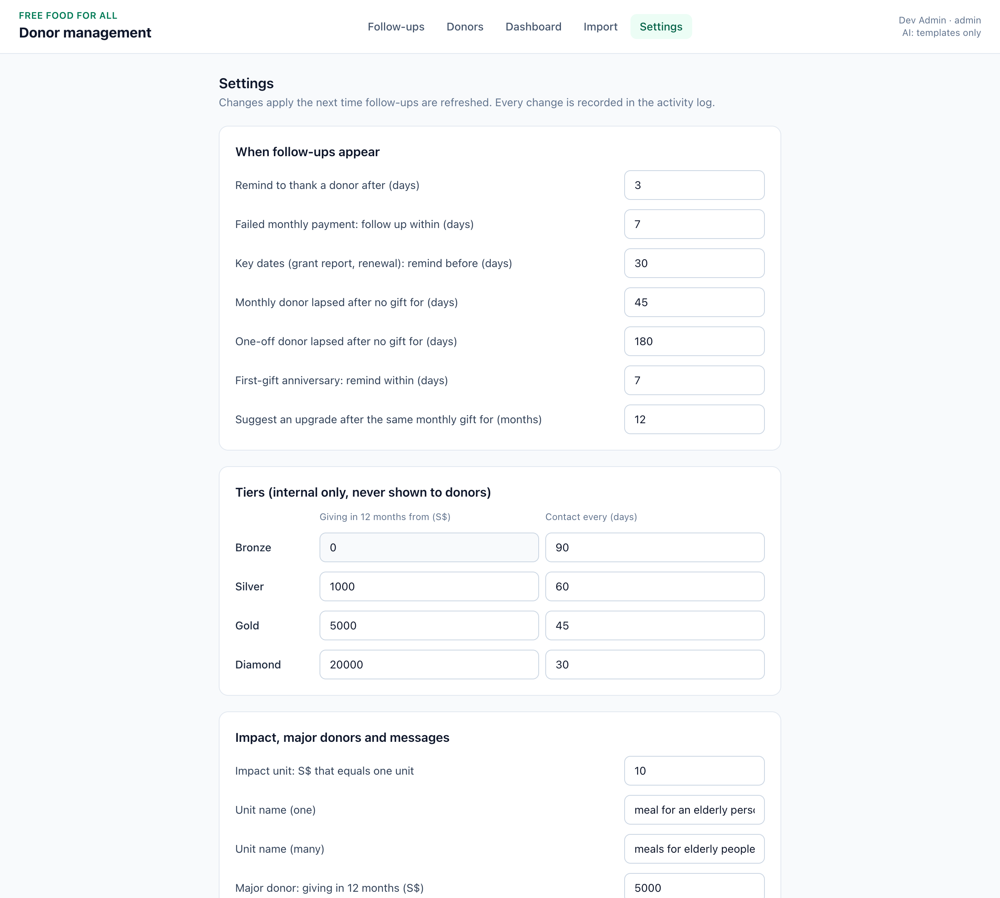

# FFFA Donor Management: Setup Guide

*28 October 2026 · Empact × FFFA AI Impact Sprint*

This guide is for whoever looks after the system for FFFA: a staff member working with an AI coding assistant, a volunteer developer or a freelancer. It covers configuration, access, approved fields, workflow rules and troubleshooting. The **Prompt Guide** has ready-to-paste instructions for an AI assistant to do each technical step.

**What FFFA receives**

| Item | Where |
|---|---|
| The code and its history | GitHub repository `FFFA-Donor-Management-System` |
| How to run it | `README.md` |
| This guide | `docs/SETUP_GUIDE.md` (and `.pdf`) |
| How staff use it day to day | `docs/staff-guide/STAFF_GUIDE.md` (and `.pdf`) |
| How to set up and change it with an AI assistant | `docs/PROMPT_GUIDE.md` (and `.pdf`) |
| Technical design (database, rules, AI safeguards) | `docs/SYSTEM_DESIGN_v1.3.md` and `docs/SYSTEM_DESIGN.pdf` |
| Read before using real data | `docs/FFFA_DISCLAIMERS.md` |
| 20-minute demo script | `docs/DEMO_SCRIPT.md` |

---

## 1. Access: take ownership on GitHub

FFFA should own the code, so access never depends on a former volunteer.

1. **Create a GitHub account** for FFFA at github.com, with a shared FFFA email (e.g. tech@ or admin@), not a personal one.
2. **Create a free organisation:** profile picture → *Your organizations* → *New organization* → *Free*, e.g. `free-food-for-all`.
3. **Move the repository:** the current owner opens the repository → *Settings* → *General* → *Danger Zone* → *Transfer ownership* → the FFFA organisation. FFFA accepts the transfer. The code, history and documents now belong to FFFA.
4. **Give people access:** *Settings* → *Collaborators and teams* → *Add people*. Use *Write* for people who make changes. Keep *Admin* for FFFA. Remove access when someone leaves.
5. **Protect the live version (recommended):** *Settings* → *Branches* → add a rule for `main` requiring a pull request before merging, so every change is reviewed before it reaches staff.
6. **Keep every service account in FFFA's name:** GitHub, Supabase (database and login), Google (AI key) and the hosting provider. Use the shared FFFA email and store passwords in FFFA's password manager.

**Staff access inside the app.** There are two roles. **Staff** use Follow-ups, Donors, Dashboard and Import. **Admins** can also change Settings, export donors to Excel and permanently delete a donor for PDPA requests. Staff accounts are added in the database's `staff` table (email, name, role). There is no screen for this yet.

---

## 2. Set up a computer

Any Mac or Windows computer. All of these are free.

| Install | From | Check |
|---|---|---|
| **Git** | git-scm.com (Mac: may already be installed) | `git --version` |
| **Node.js 20 or newer (LTS)** | nodejs.org | `node --version` |
| **GitHub Desktop**, the easiest way to sign in to GitHub and download the code | desktop.github.com | Sign in with the FFFA GitHub account |
| **An AI coding assistant** that can read files and run commands, e.g. Claude Code, GitHub Copilot in VS Code, or Cursor | The provider's website | Open it on the project folder |

Get the code: GitHub Desktop → *File* → *Clone repository* → `FFFA-Donor-Management-System`. Or use the first prompt in the Prompt Guide.

---

## 3. Run it on a computer

In a Terminal opened in the project folder:

```bash
npm install --legacy-peer-deps
npm run demo
```

Open **http://localhost:3000**. You're signed in automatically as a practice admin. Press **Ctrl + C** to stop.

| Command | What it does |
|---|---|
| `npm run demo` | Starts with 9 built-in practice donors |
| `npm run dev` | Starts with an empty database (use this to try the Excel import) |
| `npm run demo:files` | Creates two practice Excel files in `docs/samples/` (`fffa-demo-donors.xlsx`, `fffa-demo-update.xlsx`). Re-run on the day you use them, because their dates are relative to today. |
| `npm run demo:reset` | Wipes the local practice database (`.data/`) |
| `npm test` | Runs the automatic checks. All must pass before a change goes live. |
| `npm run lint` | Checks the code for type errors |

---

## 4. Configuration

**Server settings** go in a `.env` file on a computer (copy `.env.example`) or in the hosting dashboard. They hold secrets, so they are never written into code or shared in chat.

| Setting | Purpose |
|---|---|
| `DATABASE_URL` | Where data is stored (Supabase Postgres). Empty = a local practice database in `.data/`. |
| `AUTH_MODE` | `dev` = automatic practice login (computer only). `supabase` = real staff login (required online; `dev` is refused there). |
| `GEMINI_API_KEY` | Turns on AI drafting. Empty = standard templates (the header shows "AI: templates only"). |
| `GEMINI_MODEL` | Gemini model (default `gemini-3.6-flash`). |
| `PORT` | Web port (default 3000). |

**FFFA settings** are changed by an admin on the **Settings** screen. Changes apply the next time follow-ups are refreshed, and every change is recorded in the activity log with the old and new value. The values are listed in section 6.



---

## 5. Approved fields

These are the only things the system stores. The Excel import template uses the same fields.

| Record | Fields | Notes |
|---|---|---|
| **Donor** | Type (individual, corporate, grant funder); organisation name; first and last name (the contact person, for organisations) and their title; preferred name; email; mobile; how they know FFFA; programme interest (e.g. RTE, KidsLuvIt, Food Redistribution); also volunteers; major-donor tag; relationship owner | Email and mobile are never sent to the AI |
| **Donation** | Date; cash amount (S$), or for goods a description and estimated value; channel (Giving.sg, GIVE.asia, bank, PayNow, in person, other); platform reference; campaign; programme; monthly or one-off (and monthly amount); payment status (succeeded or failed); thanked | Never deleted. Mistakes are voided with a reason. |
| **Key date** | Type (sponsorship expiry, grant report, grant renewal, other); due date; label; completed | |
| **Note** | Short relationship note, author, date | No sensitive personal data |
| **Conversation** | Date, channel, summary and the exact message sent | Saved when a message is marked as sent |
| **Follow-up** | Reason, due date, status | Created by the rules, never typed in |
| **AI draft** | Generated text, approved text, who approved, when sent | Kept so quality can be checked |

**Never store** NRIC, FIN, passport or UEN numbers; bank or card details; age, income, ethnicity, health or other sensitive details. Tax-deductible receipts (IRAS) are not supported. Adding ID numbers later needs a separate, encrypted, admin-only design (system design, section 3).

---

## 6. Workflow rules

The follow-up queue is filled by these rules. All numbers can be changed on the Settings screen.

| Follow-up | Appears when | Default |
|---|---|---|
| Thank-you due | A gift (cash or goods) is not marked thanked after N days | 3 days |
| Failed payment | A monthly payment failed within the last N days | 7 days |
| Key date | A key date is due within N days | 30 days |
| Going cold | No logged contact for longer than the donor's tier allows | see tiers |
| Lapsed | No gift for N days | 45 days (monthly donors), 180 days (one-off) |
| Anniversary | First-gift anniversary within N days | 7 days |
| Upgrade ask | Same monthly amount for N months, not asked in the last year | 12 months |

| Tier (internal, never shown to donors) | Cash giving in 12 months from | Contact at least every |
|---|---|---|
| Bronze | S$0 | 90 days |
| Silver | S$1,000 | 60 days |
| Gold | S$5,000 | 45 days |
| Diamond | S$20,000 | 30 days |

- **Major donors** get personal outreach and no AI drafts: S$5,000+ in 12 months, 3+ years with FFFA, or tagged as major (Excel column `major_override`).
- **Impact figure:** S$10 = 1 meal for an elderly person. **Message sign-off:** *"Warm regards, The Free Food For All team"*. Both can be changed in Settings.
- **When rules run:** whenever someone presses the refresh icon on Follow-ups, and after a Giving.sg / GIVE.asia platform import. A follow-up is never created twice, and one that was closed stays closed.
- **Importing history:** mark old gifts `thanked = Yes` in the Excel file. Otherwise every past gift older than 3 days becomes a thank-you follow-up.
- **New imports start "going cold"** because no contact history exists yet. This settles once staff log messages.

**AI drafting rules** (the instructions are in `server/services/ai/prompts.ts` and the templates in `server/services/ai/fallback.ts`):
- The AI sees only the donor's name, giving history, interests, key date, the latest 3 notes (with emails, phone numbers and NRICs removed) and impact figures worked out by the system. It never sees email, mobile, tier or ID numbers.
- It may only use facts given to it, with no pressure or guilt, at most one ask, 80–150 words, and FFFA's sign-off.
- If the AI fails or has no key, standard templates are used.
- The system never sends anything. Staff approve and send every message themselves.
- After changing the wording, bump `PROMPT_VERSION` in `prompts.ts` so old and new drafts can be told apart.

---

## 7. What is built, and what is not

**Built and tested** (85 automatic tests):
- **Follow-ups:** rule-based queue, refresh, AI or template draft → edit → approve → copy / open in email → mark as sent (saved to conversation history), with major donors blocked from AI
- **Donors:** search, filter by type, add donor, profile with giving, tier and years with FFFA, log cash or in-kind donations (one-off or monthly), add notes, see key dates, export to Excel (admin)
- **Dashboard:** totals only
- **Import:** Excel template with preview, matching, duplicate protection and decisions on unsure rows
- **Settings:** all rules, tiers, impact figure, major-donor thresholds and sign-off (admin)
- **Behind the scenes, with no screen yet:**
  - Giving.sg / GIVE.asia CSV import (`/api/import/preview`, `/commit`)
  - follow-up done, snooze and dismiss
  - edit and archive donors
  - void donations
  - add and complete key dates
  - delete notes
  - permanent delete (admin)
  - activity log (`/api/activity`)

**Not built yet.** The README status table is the up-to-date list.

| Item | Needed before real donor data? |
|---|---|
| **Staff login** (Supabase Auth). Without it the app refuses to start online. | **Yes** |
| **Daily automatic rules run** (today someone presses refresh) | Recommended |
| **"Today" in Singapore time** (dates use UTC, so before 8am "today" can be a day behind) | Recommended |
| Screens for the behind-the-scenes actions above, a staff accounts screen, and an activity log screen | As needed |

The Prompt Guide has a ready prompt for each.

---

## 8. Put it online

Do this once, with the AI assistant (Prompt Guide, section 3). Keys go in the hosting settings, never in code or chat.

1. **Database and login: Supabase** (supabase.com, free tier to start, **Singapore region**). Copy the connection string (*Project Settings* → *Database*) into `DATABASE_URL`. Tables are created automatically on first start. Turn on daily backups.
2. **Build the login** (see section 7), then add each staff member to the `staff` table with their role.
3. **AI key: Google Gemini** (aistudio.google.com). Create a key and **turn on billing**: on the paid tier, Google does not use FFFA's data to improve its products. Put it in `GEMINI_API_KEY`. Check this against FFFA's PDPA consent first (`docs/FFFA_DISCLAIMERS.md`).
4. **Hosting: e.g. Render** (render.com → *New Web Service* → the FFFA repository). Google Cloud Run or Railway work the same way.

   | Setting | Value |
   |---|---|
   | Build command | `npm install --legacy-peer-deps && npm run build` |
   | Start command | `npm start` |
   | Environment | `DATABASE_URL`, `AUTH_MODE=supabase`, `GEMINI_API_KEY`, plus the Supabase keys the login needs |

   Every merge to `main` then updates the live site.
5. **Before entering real donors:**
   - [ ] Login works, and someone not in the staff table cannot get in
   - [ ] `DATABASE_URL` points to Supabase. Without it, data is lost on every restart.
   - [ ] Backups are on, and one restore has been tested
   - [ ] No practice data in the live database (never run `npm run demo` or `demo:files` imports against it)
   - [ ] One test donor goes through the whole flow, from import to mark as sent
   - [ ] PDPA items in `docs/FFFA_DISCLAIMERS.md` are signed off

---

## 9. Data protection (PDPA)

- Donor data lives only in FFFA's database. The AI receives no contact details or ID numbers.
- Admins can permanently delete a donor on request. Donors are otherwise archived, and donations voided, never deleted.
- Every import, edit, draft, approval, send, settings change and export is recorded in the activity log (who, what, when), without personal details.
- Excel exports contain personal data. Store them securely and delete old copies.
- `.env` is never uploaded to GitHub (`.gitignore` blocks it). Keep it that way.

---

## 10. Troubleshooting

| Problem | Fix |
|---|---|
| `npm install` fails ("ERESOLVE", "edgesOut") | `npm install --legacy-peer-deps` |
| Tests fail right after pulling new code | Run `npm install --legacy-peer-deps` again, because new packages may have been added |
| "Port 3000 is already in use" | Another copy is running. Close it, or `PORT=3001 npm run dev` |
| Practice data looks wrong or duplicated | Ctrl + C, `npm run demo:reset`, start again |
| Follow-ups list is empty after an import | Press the refresh icon at the top of the list |
| Hundreds of "Thank-you due" after importing history | Old gifts were imported as not thanked. Set `thanked = Yes` in the file. For an import already done, ask the AI assistant to mark gifts before a chosen date as thanked. |
| Excel import says a sheet or column is missing | Download a fresh template from the Import screen. Keep the sheet names and row 1 headers. |
| Drafts always say "Template" | `GEMINI_API_KEY` is missing, or billing is off |
| App won't start online: "AUTH_MODE=dev is not allowed" | Set `AUTH_MODE=supabase`. The login must be built first (section 7). |
| Live site errors | Hosting dashboard → *Logs*. Paste the error into the AI assistant, after removing keys and donor details. |

---

## 11. Bringing in a developer

Add them on GitHub with *Write* access, and share this guide, the Prompt Guide, `README.md` and the system design. Ask for every change as a pull request that FFFA approves, and remove their access when the work is done. All accounts stay in FFFA's name.
