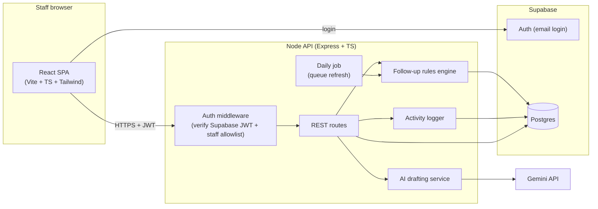
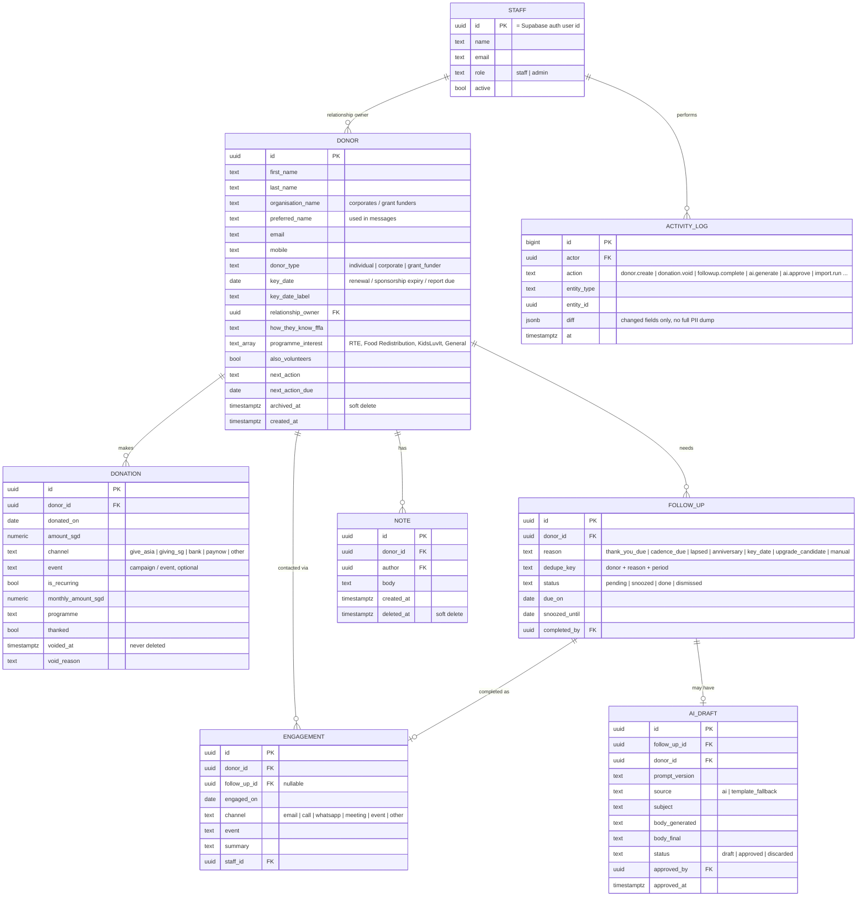
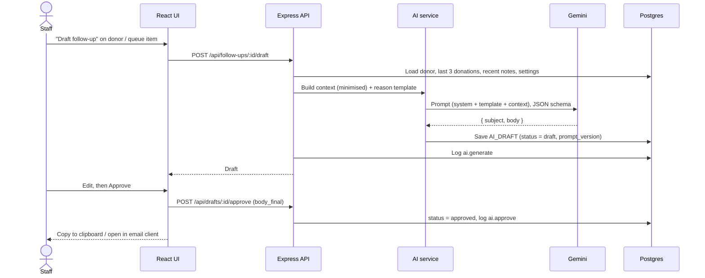

# FFFA Donor Management MVP — System Design

**Version:** v1.1 (19 Oct 2026, includes Chris's review) · **Status:** Reviewed by Systems lead · **Source of truth:** PRD v2 (8 Oct 2026) · **Owner:** Systems workstream

This document describes how we build Phase 1 (DM1–DM10) by 28 Oct 2026. Anything not in PRD v2 is out of scope unless the team agrees to add it.

---

## 1. Goals and non-goals

**Goals (Phase 1)**
- One place where FFFA staff keep every donor, donation and relationship note (DM1, DM3, DM8).
- Follow-ups surface automatically from agreed rules instead of staff memory (DM9, DM4).
- Staff can generate an AI-drafted, personal follow-up, edit it and approve it; nothing sends automatically (DM10).
- Search, filters, dashboard, CSV import, staff-only access and an activity log (DM2, DM5, DM6, DM7).

**Non-goals (Phase 1)** — from PRD v2 "Out of scope"
- Sending email/WhatsApp from the system, newsletters, campaign ads, donor portal, payments.
- Volunteer or beneficiary management (only an "also volunteers" tag on donors).
- IRAS submission (but donation records stay structured so a later export is easy).
- NRIC/FIN/UEN or any sensitive attributes (age, income, ethnicity).

---

## 2. Architecture

**Key decisions**

| Decision | Choice | Why | Alternatives considered |
|---|---|---|---|
| Frontend | Keep React 19 + Vite + TS + Tailwind from the current repo | Team already has it; fast to build | Next.js (more setup, no SSR need) |
| Backend | Keep a thin Express API in front of the DB | Gemini key must stay server-side; rules, logging and AI live in one place; client never touches the DB directly | Client → Supabase directly with Row Level Security (less code, but business rules and audit logging get scattered and the AI key still needs a server) |
| Database | Supabase Postgres | Relational data (donors ↔ donations ↔ follow-ups), free tier, table editor staff can open in an emergency, backups | Firestore (weaker for joins/aggregates), SQLite (no managed hosting/auth) |
| Auth | Supabase Auth (email + password or magic link) + server-side staff allowlist | Built-in, no custom password handling | Google Workspace SSO (depends on FFFA's setup — revisit in Phase 2) |
| AI model | Gemini Flash via `@google/genai` (exact model id verified at build time) | Already wired in repo, cheap, structured JSON output | Claude / GPT (equally viable; switching is a single service file) |
| Follow-up queue | **Materialised**: rules write `follow_ups` rows; daily job + on-demand refresh | Gives each follow-up a status/history (DM4 "removes from pending"), lets staff snooze/complete, and the dashboard can count them cheaply | Compute on read (simpler, but no status tracking or history) |
| Hosting | Container on Cloud Run (or Render) — decide with FFFA | FFFA has hosting funding; container keeps us portable | Vercel (fine for SPA, awkward for the daily job) |

---

## 3. Data model

**Computed, never stored** — a `donor_summary` view derives these on read so they can't go stale:
last donation (date, amount, event), last engagement (date, channel), average donation amount, average days between donations, 12-month giving total, **tier** and **days since last engagement**.

**Tiers (internal only).** `tier_settings` holds Bronze / Silver / Gold / Diamond with a 12-month giving threshold (e.g. ≥ S$5,000 = Gold) and a **contact cadence in days** per tier. Tier is calculated from 12-month giving, never set by hand. Tiers flagged `personal_outreach` (default: Diamond) are excluded from AI drafting, per PRD "major donors get a human". Tiers are never sent to the AI or shown to donors.

Other config tables: `rule_settings` (thresholds, editable by admin) and `org_settings` (impact unit, e.g. "S$3 = 1 RTE meal", org signature).

**Data guardrails (PRD §3):** no NRIC/FIN/UEN, no age/income/ethnicity; dummy or de-identified data only until FFFA authorises live data.

---

## 4. Follow-up rules engine (DM9)

Runs daily (cron) and on demand ("Refresh queue" button). Each rule is a pure function `(donor, donations, settings, today) → FollowUpCandidate | null`, so rules are easy to unit-test and to add later.

| Rule | Fires when | Default threshold (FFFA to confirm) | Priority |
|---|---|---|---|
| `thank_you_due` | A donation has `thanked = false` and is ≥ N days old | N = 3 days | High |
| `cadence_due` | Days since last engagement ≥ the donor's tier cadence (going cold) | Per tier in `tier_settings` | High |
| `lapsed` | Recurring donor with no donation for N days, or one-off donor with none for M days | N = 45, M = 365 | High |
| `key_date` | `key_date` (renewal / sponsorship expiry / grant report) within N days | N = 30 | High |
| `anniversary` | First-donation anniversary within the next N days | N = 7 | Medium |
| `upgrade_candidate` | Recurring at the same monthly amount for ≥ 12 months, not asked in the last 12 months | 12 months | Low |

**Idempotency:** each candidate has a `dedupe_key` (e.g. `donor:123|lapsed|2026-10`). The engine upserts on that key, so re-running never duplicates and a completed follow-up is not recreated in the same period.

**Completing a follow-up** records an `ENGAGEMENT` (date, channel, summary), which resets that donor's cadence clock.

**Personal-outreach tiers:** still appear in the queue, but are tagged "personal outreach" and the AI draft button is disabled for them (PRD: major donors get a human).

---

## 5. AI drafting flow (DM10)

- **Prompt templates per reason** (thank-you, lapsed, anniversary, key date, upgrade ask), versioned in code (`prompt_version`) so we can compare outputs.
- **Context minimisation:** the model gets first name, donor type, tenure, donation amounts/dates/programme, relationship notes, the impact unit and the reason. **Never** email, mobile or address.
- **Tone guardrails** in the system prompt: warm, specific, no guilt, upgrade asks modest and concrete ("S$10 → S$15 = X more meals"), Singapore English, FFFA voice.
- **Nothing sends from the system.** Approve = copy or `mailto:`; sending stays with staff (PRD out-of-scope).
- **Failure mode:** if Gemini fails or times out, fall back to the static template for that reason (`source = template_fallback`) so staff are never blocked.
- **Evaluation:** a small fixed set of ~10 dummy donors × 5 reasons; we review outputs for tone, accuracy (no invented facts) and length each time prompts change.

---

## 6. API (v1)

All routes require a valid staff session. Writes go through the activity logger.

| Method | Route | PRD |
|---|---|---|
| GET | `/api/donors?query=&type=&tier=&lastDonationBefore=&owner=` | DM1, DM2 |
| POST / PATCH | `/api/donors`, `/api/donors/:id` | DM1 |
| GET | `/api/donors/:id` (profile: summary, donations, engagements, notes, follow-ups, drafts) | DM3 |
| POST / DELETE | `/api/donors/:id/notes`, `/api/notes/:id` (soft delete) | DM3 |
| POST | `/api/donors/:id/donations`, `/api/donations/:id/void` | DM8 |
| POST | `/api/donors/:id/engagements` | DM3, DM4 |
| GET | `/api/follow-ups?status=pending` (the "Today" queue) | DM9 |
| POST | `/api/follow-ups/refresh` | DM9 |
| POST | `/api/follow-ups/:id/complete` (creates an engagement) · `/snooze` · `/dismiss` | DM4 |
| POST | `/api/follow-ups/:id/draft` · `/api/drafts/:id/approve` · `/api/drafts/:id/discard` | DM10 |
| GET | `/api/dashboard` (aggregates + monthly series) | DM5 |
| POST | `/api/import/preview` · `/api/import/commit` (CSV) | DM6 |
| GET / PATCH | `/api/settings` (admin: rules, tiers, impact unit) | DM9, DM10 |
| GET | `/api/activity?entity=` (admin only) | DM7 |
| POST / DELETE | `/api/donors/:id/archive` · `DELETE /api/donors/:id` (admin only, PDPA requests) | DM1 |

**Delete semantics.** Each resource gets the operation its data needs rather than a blanket DELETE:

| Resource | Operation | Why |
|---|---|---|
| Donor | Archive (soft); hard delete admin-only | PDPA requests to remove personal data |
| Donation | Void with reason, never deleted | Financial record; feeds a later IRAS export |
| Note | Soft delete (author or admin) | Recoverable mistakes |
| Follow-up | Dismiss | Keeps queue history |
| AI draft | Discard | Keeps generation history for evaluation |
| Activity log | Never | Audit trail |

---

## 7. Screens

1. **Login**
2. **Today** — pending follow-ups grouped by priority; actions: draft, complete, snooze. *(The demo's home screen.)*
3. **Donors** — table with search and filters.
4. **Donor profile** — details, donations, notes timeline, follow-ups, "Log donation", "Draft follow-up".
5. **Dashboard** — total/active donors, donors by tier, pending follow-ups, upgrade candidates, plus two monthly charts: **donations** and **outbound engagements** (from the engagements table, not the activity log). Aggregates only; built after the core flow.
6. **Import** — upload CSV, preview with validation errors, commit.
7. **Settings** (admin) — rule thresholds, tier thresholds and cadences, impact unit, staff allowlist.

---

## 8. Security (DM7, PRD §3)

- Supabase Auth login; the API verifies the JWT on every request **and** checks the user is in the `staff` table and active.
- Roles: `staff` (day-to-day), `admin` (settings, staff list, activity log).
- The browser never gets DB credentials; Postgres Row Level Security set to deny-all for the anon key, server uses the service role.
- Secrets (`GEMINI_API_KEY`, Supabase service key) only in server env.
- Activity log for every write and every AI generate/approve (who, what, when, changed fields).
- Dashboards and exports show aggregates only; no bulk PII export in Phase 1.
- Dummy data in all environments until FFFA signs off on live data.

---

## 9. Changes from the current repo

| Current (AI Studio demo) | Phase 1 plan |
|---|---|
| In-memory arrays in `server.ts` | Supabase Postgres |
| No login | Supabase Auth + staff allowlist |
| Single 1,200-line `App.tsx` | `src/pages/*`, `src/components/*`, `src/lib/api.ts` |
| Single `server.ts` | `server/routes/*`, `server/services/{rules,ai,activity}.ts`, `server/db.ts` |
| Newsletter studio, campaigns, AI insights | Removed from nav (Phase 2 per PRD); code kept on a branch |
| Generic sample data with real-looking corporate emails | Clearly fictional FFFA-style seed data (RTE, KidsLuvIt, Give Asia, Giving SG) |
| README describes demo features | Rewrite README to match this design once approved |

---

## 10. Workstream ownership (Systems)

Estimates are in ideal working days, sized per task so the load is even.

| Person | Owns | PRD | Days |
|---|---|---|---|
| **Ghanashyam (lead)** | Architecture, shared schema/types and repo restructure (1.5) · AI drafting service, prompts and approve flow (2.5) · AI evaluation with Lynn (0.5) · integration, stand-ups, demo prep (1.5) | DM10 | ~6 |
| **Swaraj** | Donor, donation and notes API (2) · follow-up rules engine and follow-up API (3) · activity log (1) | DM1–DM4, DM8, DM9, DM7 (log) | ~6 |
| **Chris** | Auth and staff access (1.5) · screens: Login, Today, Donors, Donor profile, Import, Settings (5) | DM7 (auth), DM1–DM4 (UI) | ~6.5 |
| **Lynn** | Seed data (0.5) · CSV import back end (1.5) · dashboard API and screen (1.5) · AI evaluation set (0.5) · test checklist (1) | DM5, DM6, DM10 (eval) | ~5 |

**Ways of working**
- **Day 1, together:** agree the shared schema, TypeScript types and API conventions before building, so everyone can work in parallel.
- **Peer code review:** every pull request is reviewed by one other teammate; reviewers rotate so everyone understands every part of the system.
- **Short stand-ups** (async in the group is fine): done, next, blocked.
- **Team demos:** the lead opens and closes; each owner presents the part they built.

People & Processes (Fiona's team) provides: FFFA field confirmation, rule thresholds, impact unit, tone guidance and tester names.

---

## 11. Milestones

| Date | Milestone |
|---|---|
| 19 Oct | Design v1.1; platform foundation (schema, types, DB layer, auth hook, activity log hook, AI service) |
| 20 Oct | Donor API, rules engine core, Today + profile screens on seed data; AI draft → approve working |
| **21 Oct** | **Session 2: team demo to mentor of Today → profile → AI draft → approve** |
| 24 Oct | Engagements, tiers, dashboard (with charts), import, settings; FFFA testing |
| 27 Oct | Fixes, staff guide, handover notes |
| **28 Oct** | **Final demo and handover** |

---

## 12. Assumptions and open questions

**Assumptions** (we build on these; FFFA can correct them anytime)
- Donor fields: as listed in section 3, built and tested on dummy data until FFFA shares a template or de-identified sample.
- Rule thresholds: the defaults in section 4, editable by an admin in Settings.
- Impact unit: a placeholder (e.g. "S$X = 1 RTE meal") until FFFA confirms the figure.
- AI drafts: any staff user can approve; major donors are excluded from AI drafting.
- Email: staff send from their own email client; nothing sends from the system.
- Hosting and post-handover ownership: decided with FFFA before 28 Oct; the build stays container-portable.

**Open questions** (already sent to FFFA in the question sheet)
1. **Do you hold any other donor data, such as demographics (age, income, ethnicity, dialect) or preferences?** FFFA's stated purpose is clarity and comparison. *Design note:* PRD §3 keeps these fields out of Phase 1; if FFFA has them, we revisit as a Phase 2 decision with privacy controls.
2. **Does your team use a dashboard for key operational figures (active donors, active beneficiaries, inventory availability, etc.)?** *Design note:* the Phase 1 dashboard (DM5) covers donor figures only; beneficiaries and inventory stay out of scope, but the answer tells us what staff are used to seeing.
