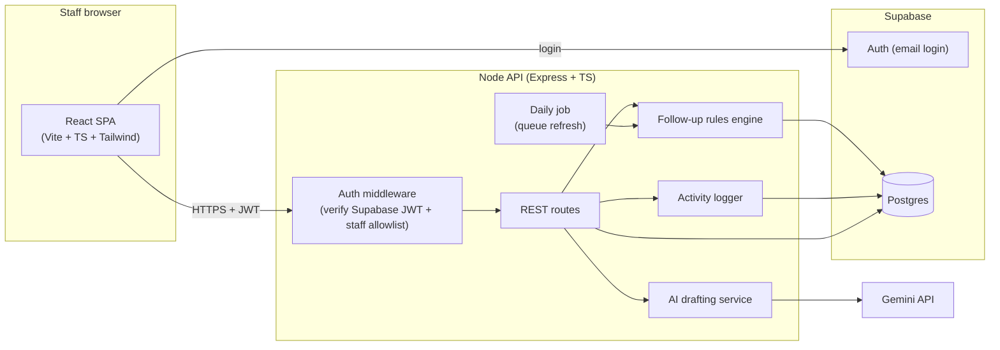
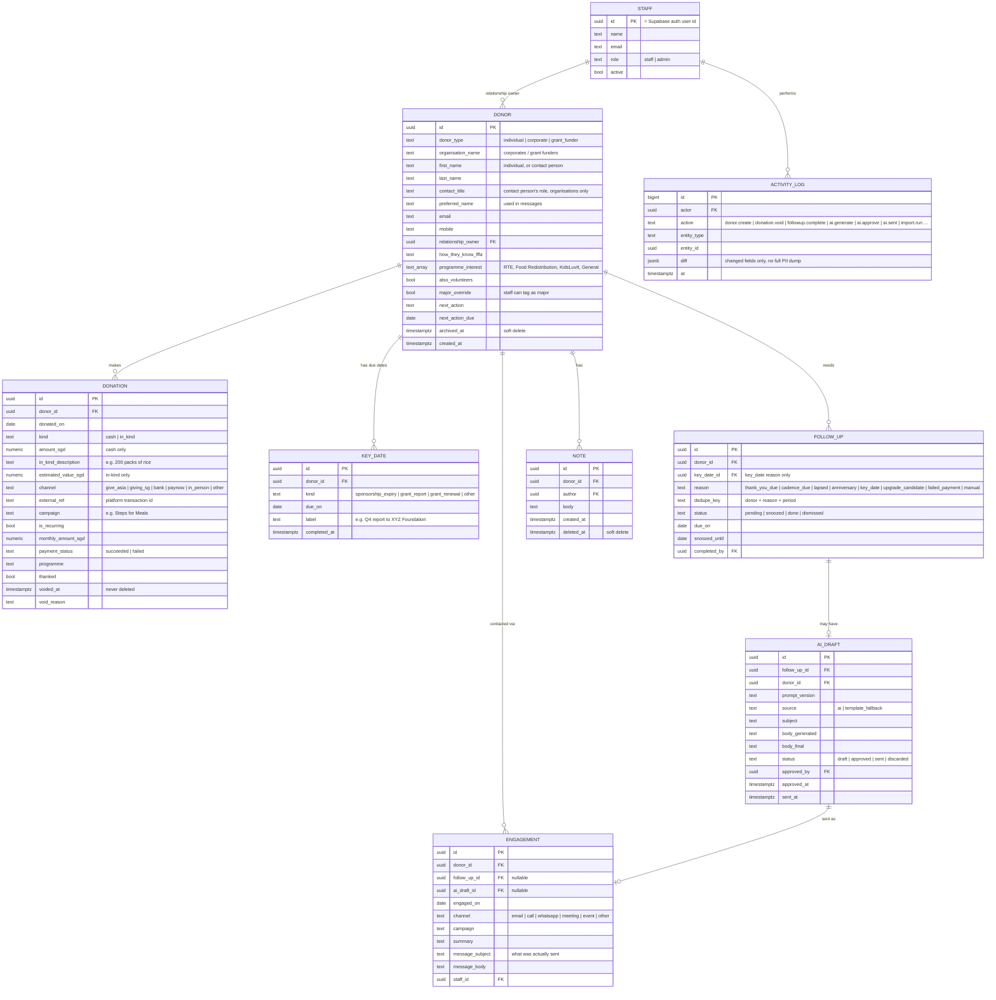
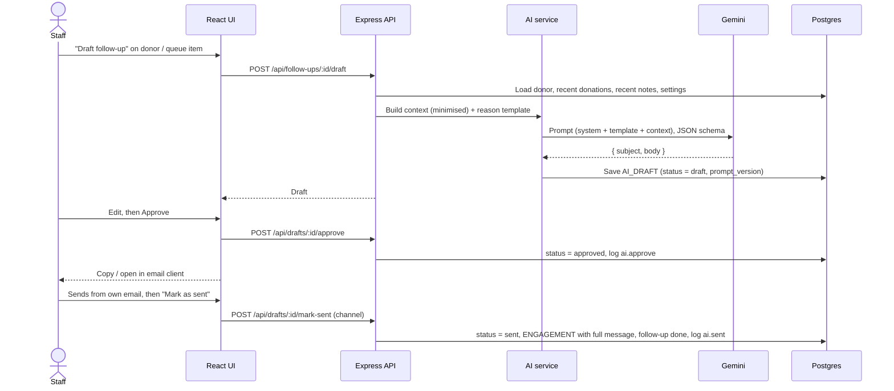

# FFFA Donor Management MVP — System Design

**Version:** v1.2 (20 Oct 2026, includes FFFA's feedback) · **Status:** Reviewed by Systems lead · **Source of truth:** PRD v2 + FFFA feedback of 20 Oct (to be folded into PRD v3) · **Owner:** Systems workstream

This document describes how we build Phase 1 (DM1–DM10) by 28 Oct 2026. Anything not in PRD v2 or FFFA's 20 Oct feedback is out of scope unless the team agrees to add it.

**What changed in v1.2 (FFFA feedback, 20 Oct):** campaign on donations; organisation + contact person; major donor rule ($5,000+/yr or 3+ years, or tagged by staff); one-off donors lapse after 6 months; impact unit S$10 = 1 meal for one elderly person; multiple grant/sponsor due dates per donor; in-kind donations; failed monthly payments; "mark as sent" keeps the sent message on the donor's profile; import matching across Giving.sg and GIVE.asia; a documented path to add NRIC/UEN later. Schema changes land as migration `002` (001 is merged).

---

## 1. Goals and non-goals

**Goals (Phase 1)**
- One place where FFFA staff keep every donor, donation and relationship note (DM1, DM3, DM8).
- Follow-ups surface automatically from agreed rules instead of staff memory (DM9, DM4).
- Staff can generate an AI-drafted, personal follow-up, edit it and approve it; nothing sends automatically (DM10).
- Search, filters, dashboard, CSV import, staff-only access and an activity log (DM2, DM5, DM6, DM7).

**Non-goals (Phase 1)** — from PRD v2 "Out of scope"
- Sending email/WhatsApp from the system, newsletters, campaign ads, donor portal, payments.
- Volunteer or beneficiary management (only an "also volunteers" tag on donors).
- IRAS submission (but donation records stay structured so a later export is easy).
- NRIC/FIN/UEN or any sensitive attributes (age, income, ethnicity).

---

## 2. Architecture

**Key decisions**

| Decision | Choice | Why | Alternatives considered |
|---|---|---|---|
| Frontend | Keep React 19 + Vite + TS + Tailwind from the current repo | Team already has it; fast to build | Next.js (more setup, no SSR need) |
| Backend | Keep a thin Express API in front of the DB | Gemini key must stay server-side; rules, logging and AI live in one place; client never touches the DB directly | Client → Supabase directly with Row Level Security (less code, but business rules and audit logging get scattered and the AI key still needs a server) |
| Database | Supabase Postgres | Relational data (donors ↔ donations ↔ follow-ups), free tier, table editor staff can open in an emergency, backups | Firestore (weaker for joins/aggregates), SQLite (no managed hosting/auth) |
| Auth | Supabase Auth (email + password or magic link) + server-side staff allowlist | Built-in, no custom password handling | Google Workspace SSO (depends on FFFA's setup — revisit in Phase 2) |
| AI model | Gemini Flash via `@google/genai` (exact model id verified at build time) | Already wired in repo, cheap, structured JSON output | Claude / GPT (equally viable; switching is a single service file) |
| Follow-up queue | **Materialised**: rules write `follow_ups` rows; daily job + on-demand refresh | Gives each follow-up a status/history (DM4 "removes from pending"), lets staff snooze/complete, and the dashboard can count them cheaply | Compute on read (simpler, but no status tracking or history) |
| Hosting | Container on Cloud Run (or Render) — decide with FFFA | FFFA has hosting funding; container keeps us portable | Vercel (fine for SPA, awkward for the daily job) |

---

## 3. Data model

`donors.key_date` / `key_date_label` from v1.1 move into the `KEY_DATE` table, so a grant funder can have a report deadline **and** a renewal date. `donations.event` becomes `campaign`.

**Organisations.** A corporate or grant funder is one donor record: `organisation_name` is the donor, and first/last name, `contact_title`, email and mobile describe the contact person. Messages greet the contact person by name. Campaign + organisation together support FFFA's campaign reporting and grant matching.

**In-kind donations** (food, essentials) are donations with `kind = in_kind`, a description and an estimated value. They show on the profile and in reports, and they get thank-yous, but tiers and the major rule count **cash only**.

**Computed, never stored**: a `donor_summary` view derives these on read so they can't go stale:
last donation (date, amount, campaign), last engagement (date, channel), average donation amount, average days between donations, 12-month cash giving, years with FFFA, **tier**, **is_major** and **days since last engagement**. Failed payments and voided donations are excluded from all totals.

**Major donors (FFFA rule).** `is_major` = 12-month cash giving ≥ S$5,000 **or** first gift ≥ 3 years ago **or** `major_override` set by staff. Both thresholds live in `org_settings`. Major donors get personal outreach from staff: they still appear in the queue, but AI drafting is disabled for them (PRD: "major and long-standing donors get a human").

**Tiers (internal only)** stay separate from "major": `tier_settings` holds Bronze / Silver / Gold / Diamond with a 12-month giving threshold and a **contact cadence in days** per tier, used by the `cadence_due` rule. Tier is calculated, never set by hand, and never sent to the AI or shown to donors.

Other config tables: `rule_settings` (thresholds, editable by admin) and `org_settings` (impact unit **S$10 = 1 meal for one elderly person**, major-donor thresholds, org signature).

**Data guardrails (PRD §3):** no NRIC/FIN/UEN, no age/income/ethnicity; **dummy data only** (confirmed by FFFA).

**Adding NRIC/UEN later (for IRAS tax deduction receipts)** needs no rebuild: a separate `tax_identities` table (donor_id, id_type NRIC/FIN/UEN, encrypted value, consent date) added by its own migration, readable by admins only, never returned by donor list/profile endpoints and never sent to the AI. Donation records already carry date, amount, kind and channel, which an IRAS export needs.

---

## 4. Follow-up rules engine (DM9)

Runs daily (cron) and on demand ("Refresh queue" button). Each rule is a pure function `(donor, donations, key dates, settings, today) → FollowUpCandidate | null`, so rules are easy to unit-test and to add later.

| Rule | Fires when | Default threshold | Priority |
|---|---|---|---|
| `thank_you_due` | A donation (cash or in-kind) has `thanked = false` and is ≥ N days old | N = 3 days | High |
| `failed_payment` | A recurring donor's latest monthly payment has `payment_status = failed` | Within 7 days of the failure | High |
| `key_date` | A `KEY_DATE` (sponsorship expiry, grant report, grant renewal) is due within N days and not completed; one follow-up per key date | N = 30 | High |
| `cadence_due` | Days since last engagement ≥ the donor's tier cadence (going cold) | Per tier in `tier_settings` | High |
| `lapsed` | Recurring donor with no successful donation for N days, or one-off donor with none for M days | N = 45, **M = 180 (6 months, FFFA)** | High |
| `anniversary` | First-donation anniversary within the next N days | N = 7 | Medium |
| `upgrade_candidate` | Recurring at the same monthly amount for ≥ 12 months, not asked in the last 12 months | 12 months | Low |

Thresholds confirmed by FFFA on 20 Oct ("defaults are fine", except one-off lapse at 6 months).

**Idempotency:** each candidate has a `dedupe_key` (e.g. `donor:123|lapsed|2026-10`, or `keydate:456` for key dates). The engine upserts on that key, so re-running never duplicates and a completed follow-up is not recreated in the same period.

**Completing a follow-up** records an `ENGAGEMENT` (date, channel, summary, and the message if one was sent), which resets that donor's cadence clock. Completing a `key_date` follow-up can also mark the key date done.

**Major donors:** still appear in the queue, tagged "personal outreach", with the AI draft button disabled.

---

## 5. AI drafting flow (DM10)

- **The sent message stays with FFFA** (FFFA feedback): "Mark as sent" saves the exact subject and body on an engagement, so the full conversation history lives on the donor's profile, not only in a staff inbox. Messages staff write themselves (e.g. to major donors) can be logged the same way through `POST /api/donors/:id/engagements`.
- **Prompt templates per reason** (thank-you, failed payment, key date, check-in, lapsed, anniversary, upgrade ask), versioned in code (`prompt_version`) so we can compare outputs.
- **Context minimisation:** the model gets the display name (contact person for organisations), donor type, organisation name, tenure, donation amounts/dates/campaign/programme, in-kind descriptions, relationship notes, the impact unit and the reason. **Never** email, mobile, tier or tax identifiers; notes are scrubbed of emails, phone numbers and NRICs.
- **Impact unit:** S$10 = 1 meal for one elderly person. Meal counts and upgrade figures are computed in code (e.g. "S$30 → S$45 a month = 1 more meal each month"), never by the model.
- **Failed payments:** a short, low-friction note with no guilt, asking them to update their card details on the platform they give through.
- **Tone guardrails** in the system prompt: warm, specific, no guilt, at most one modest ask, Singapore English, FFFA voice.
- **Nothing sends from the system.** Sending stays with staff (PRD out of scope); FFFA confirmed they like that "someone on the team always reviews and sends every message".
- **Failure mode:** if Gemini fails or times out, fall back to the static template for that reason (`source = template_fallback`) so staff are never blocked.
- **Evaluation:** a small fixed set of ~10 dummy donors × each reason; we review outputs for tone, accuracy (no invented facts) and length each time prompts change.

---

## 6. API (v1)

All routes require a valid staff session. Writes go through the activity logger.

| Method | Route | PRD |
|---|---|---|
| GET | `/api/donors?query=&type=&tier=&lastDonationBefore=&owner=` | DM1, DM2 |
| POST / PATCH | `/api/donors`, `/api/donors/:id` | DM1 |
| GET | `/api/donors/:id` (profile: summary, donations, engagements, notes, follow-ups, drafts) | DM3 |
| POST / DELETE | `/api/donors/:id/notes`, `/api/notes/:id` (soft delete) | DM3 |
| POST | `/api/donors/:id/donations` (cash or in-kind), `/api/donations/:id/void` | DM8 |
| POST | `/api/donors/:id/engagements` | DM3, DM4 |
| GET | `/api/follow-ups?status=pending` (the "Today" queue) | DM9 |
| POST | `/api/follow-ups/refresh` | DM9 |
| POST | `/api/follow-ups/:id/complete` (creates an engagement) · `/snooze` · `/dismiss` | DM4 |
| POST | `/api/follow-ups/:id/draft` · `/api/drafts/:id/approve` · `/api/drafts/:id/mark-sent` · `/api/drafts/:id/discard` | DM10 |
| GET / POST / PATCH | `/api/donors/:id/key-dates`, `/api/key-dates/:id` (incl. mark complete) | DM9 |
| GET | `/api/dashboard` (aggregates + monthly series) | DM5 |
| POST | `/api/import/preview` · `/api/import/commit` (CSV; see import matching below) | DM6 |
| GET / PATCH | `/api/settings` (admin: rules, tiers, impact unit) | DM9, DM10 |
| GET | `/api/activity?entity=` (admin only) | DM7 |
| POST / DELETE | `/api/donors/:id/archive` · `DELETE /api/donors/:id` (admin only, PDPA requests) | DM1 |

**Delete semantics.** Each resource gets the operation its data needs rather than a blanket DELETE:

| Resource | Operation | Why |
|---|---|---|
| Donor | Archive (soft); hard delete admin-only | PDPA requests to remove personal data |
| Donation | Void with reason, never deleted | Financial record; feeds a later IRAS export |
| Note | Soft delete (author or admin) | Recoverable mistakes |
| Follow-up | Dismiss | Keeps queue history |
| AI draft | Discard | Keeps generation history for evaluation |
| Activity log | Never | Audit trail |

**Import matching (Giving.sg and GIVE.asia, FFFA feedback).** The same person often gives on both platforms. On import:
1. **Donations** are de-duplicated by `(channel, external_ref)`, so re-importing the same export never double-counts.
2. **Donors** are matched by normalised email, then by normalised mobile (+65 stripped, digits only).
3. Rows that match on name only, or match two different donors, are **not merged automatically**: the preview lists them for staff to confirm "same person" or "new donor".
4. Matched donations attach to the existing donor with their own `channel`, so the profile shows giving across both platforms.

---

## 7. Screens

1. **Login**
2. **Today** — pending follow-ups grouped by priority; actions: draft, complete, snooze. *(The demo's home screen.)*
3. **Donors** — table with search and filters.
4. **Donor profile** — details, donations, notes timeline, follow-ups, "Log donation", "Draft follow-up".
5. **Dashboard** — total/active donors, donors by tier, pending follow-ups, upgrade candidates, plus two monthly charts: **donations** and **outbound engagements** (from the engagements table, not the activity log). Aggregates only; built after the core flow.
6. **Import** — upload CSV, preview with validation errors, commit.
7. **Settings** (admin) — rule thresholds, tier thresholds and cadences, impact unit, staff allowlist.

---

## 8. Security (DM7, PRD §3)

- Supabase Auth login; the API verifies the JWT on every request **and** checks the user is in the `staff` table and active.
- Roles: `staff` (day-to-day), `admin` (settings, staff list, activity log).
- The browser never gets DB credentials; Postgres Row Level Security set to deny-all for the anon key, server uses the service role.
- Secrets (`GEMINI_API_KEY`, Supabase service key) only in server env.
- Activity log for every write and every AI generate/approve (who, what, when, changed fields).
- Dashboards and exports show aggregates only; no bulk PII export in Phase 1.
- Dummy data in all environments (confirmed by FFFA, 20 Oct).
- NRIC/UEN, when added later, go in a separate encrypted, admin-only table (section 3).

---

## 9. Implementation status

| Done (merged in PR #1) | Next |
|---|---|
| Schema `001_init.sql`, DB layer (Postgres / PGlite), auth hook, activity log, shared types | Migration `002`: FFFA feedback fields (campaign, contact title, major override, in-kind, payment status, external ref, key dates table, sent messages) |
| DM10 draft / approve / discard with template fallback | DM10 "mark as sent", major-donor block, S$10 impact unit, failed-payment template |
| Old AI Studio UI kept on `legacy/ai-studio-demo` | Slices per section 10 |

---

## 10. Workstream ownership (Systems)

Estimates are in ideal working days. v1.2 adds about 4 days of work from FFFA's feedback, spread so the load stays even (activity log moves from Swaraj to Lynn).

| Person | Owns | PRD | Days |
|---|---|---|---|
| **Ghanashyam (lead)** | Architecture, schema/types, migration 002 (1.5) · AI drafting incl. mark-as-sent, major block, impact unit, failed-payment template (3) · AI evaluation with Lynn (0.5) · integration, stand-ups, demo prep (1.5) | DM10 | ~6.5 |
| **Swaraj** | Donor, donation (cash + in-kind) and notes API (2.5) · rules engine incl. key dates and failed payments, follow-up API (3.5) · key dates API (0.5) | DM1–DM4, DM8, DM9 | ~6.5 |
| **Chris** | Auth and staff access (1.5) · screens: Login, Today, Donors, Donor profile (incl. organisation contact, in-kind, key dates, conversation history), Import, Settings (5.5) | DM7 (auth), DM1–DM4 (UI) | ~7 |
| **Lynn** | Seed data (0.5) · CSV import incl. cross-platform matching (2.5) · dashboard API and screen (1.5) · activity log read endpoint (1) · AI evaluation set (0.5) · test checklist (1) | DM5, DM6, DM7 (log), DM10 (eval) | ~7 |

**Ways of working**
- **Day 1, together:** agree the shared schema, TypeScript types and API conventions before building, so everyone can work in parallel.
- **Peer code review:** every pull request is reviewed by one other teammate; reviewers rotate so everyone understands every part of the system.
- **Short stand-ups** (async in the group is fine): done, next, blocked.
- **Team demos:** the lead opens and closes; each owner presents the part they built.

People & Processes (Fiona's team) provides: FFFA field confirmation, rule thresholds, impact unit, tone guidance and tester names.

---

## 11. Milestones

| Date | Milestone |
|---|---|
| 19 Oct | ✅ Platform foundation + DM10 draft/approve merged (PR #1) |
| 20 Oct | Design v1.2 with FFFA feedback; PRD v3 draft to Fiona |
| **21 Oct** | **Session 2: recalibrate as a team and build** (walk through v1.2, confirm owners, start slices) |
| 23 Oct | Migration 002; donors/donations/notes API; rules engine core; Today + profile screens on seed data |
| 25 Oct | Full flow: queue → draft → approve → mark as sent → history on profile; import + dashboard |
| 26–27 Oct | FFFA testing (tester confirmed), fixes, staff guide, handover notes |
| **28 Oct** | **Final demo and handover** |

---

## 12. Confirmed decisions, assumptions and open questions

**Confirmed by FFFA (20 Oct)**
- Donor fields as listed, plus campaign and organisation contact person.
- Major donor: S$5,000+ a year or 3+ years with FFFA, or tagged by staff.
- Rule defaults fine; one-off donors lapse after 6 months.
- Tester: FFFA's respondent. Data: dummy only. Impact unit: S$10 = one meal for one elderly person.

**Assumptions** (we build on these; FFFA can correct them anytime)
- AI drafts: any staff user can approve; major donors are excluded from AI drafting.
- Email: staff send from their own email client and then mark the message as sent.
- In-kind donations count towards thank-yous and reports, not towards tiers or major status.
- Hosting and post-handover ownership: decided with FFFA before 28 Oct; the build stays container-portable.

**Question sheet (answered by FFFA's email, 20 Oct)**
1. *Other donor data such as demographics (age, income, ethnicity, dialect) or preferences?* Answered: the listed fields work, plus campaign and organisation contact person. No demographic fields; this also matches PRD §3.
2. *Operations dashboard (active donors, beneficiaries, inventory)?* Not needed for Phase 1: the dashboard covers donor figures only (DM5), with donations by campaign added for FFFA's campaign reporting.

**Still open:** hosting and who owns and maintains the system after handover (before 28 Oct).
