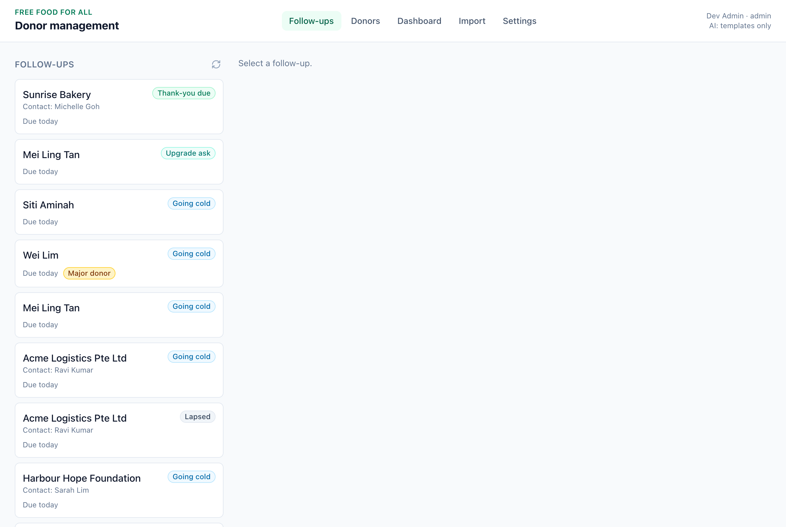
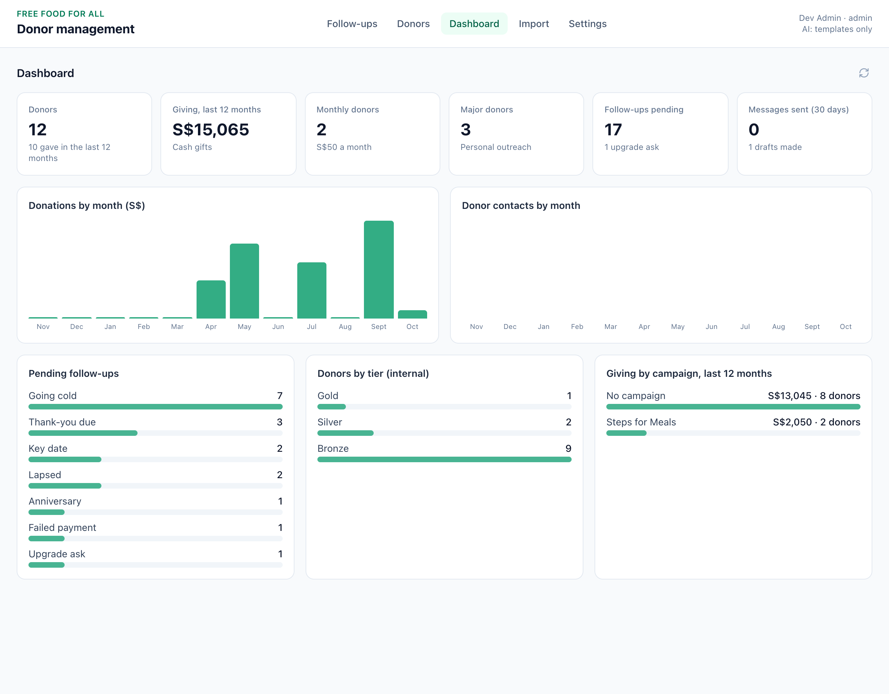
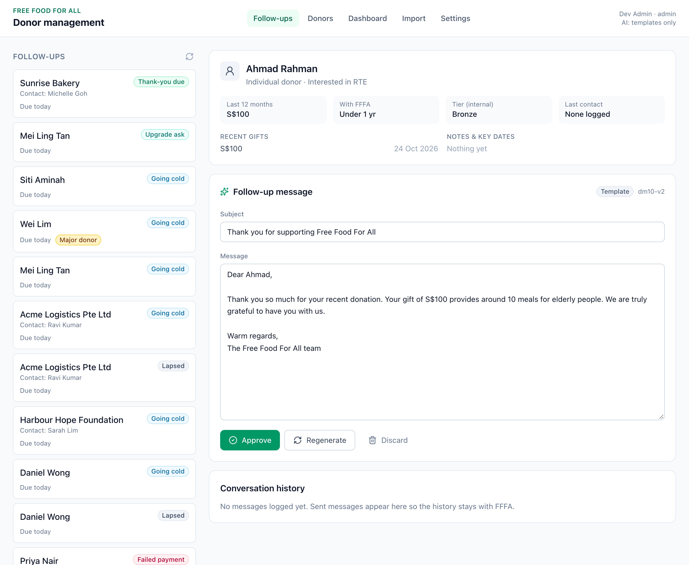
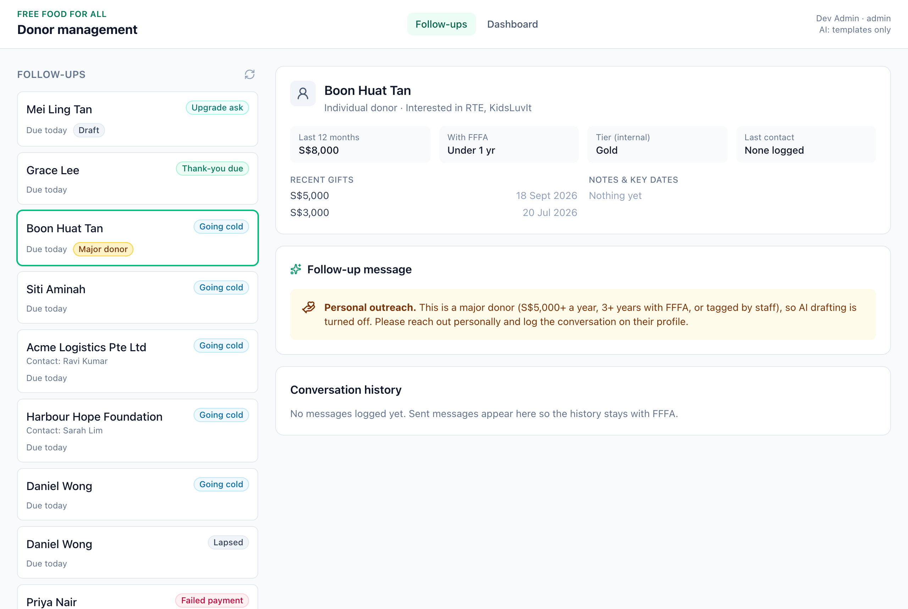

# FFFA Donor Management: Staff Operating Guide

*Version 1 · 28 October 2026 · for FFFA staff*

This system keeps every donor relationship in one place. It tells you **who to follow up with and why**, helps you write a warm, personal message, and keeps a record of every conversation, so relationships stay with FFFA even when people move on. Nothing is ever sent without a staff member reading and approving it.

> Until the system is online, it runs on a laptop with practice donors (made-up people). The **Setup Guide** explains how it's run and put online. Once it's live you open it from a web link with your own login, and everything below works the same way.

---

## 1. Daily (10–15 minutes)

**Review the queue and donor history.** Open **Follow-ups**. Each item says why the donor needs attention today. Click a name to see who they are, what they've given, notes, key dates and past conversations.

**Complete approved outreach.** Draft, check and approve the message, then send it from your own email or WhatsApp (section 4). Major donors get a personal call, meeting or note instead (section 5).

**Record the outcome and the next action.** Click **Mark as sent** for messages, or **Done** for a call or meeting, with a one-line summary. If something needs to happen later, set the donor's **Next action** and due date (section 6).

---

## 2. Monthly (about 1 hour, ideally with the team lead)

**Review trends, lapsed donors and recurring support.** On the **Dashboard**, compare giving and contacts with last month. Look at how many follow-ups are *Lapsed*, *Failed payment* and *Going cold*, and whether the number of monthly donors went up or down. Decide who will personally reach out to lapsed donors who used to give regularly.

**Check quality and priority relationships.**
- Read 5 sent messages from the month. Were they accurate, warm and free of mistakes? Share good examples and fix recurring problems (see the Prompt Guide).
- Go through major donors, sponsors and grant funders: does each have an owner, a recent conversation and upcoming key dates recorded?
- Clear old items: anything snoozed or pending for more than a month should be done or dismissed.
- Import the month's Giving.sg and GIVE.asia exports (section 10) if not already done.

---

## 3. What each follow-up means

| Label | Why it appears | What to do |
|---|---|---|
| **Thank-you due** | A gift (money or goods) from 3+ days ago hasn't been thanked | Send a thank-you |
| **Failed payment** | A monthly gift on Giving.sg / GIVE.asia didn't go through (in the last 7 days) | Gentle note asking them to update their card. No pressure. |
| **Key date** | A sponsorship renewal, grant report or grant renewal is due within 30 days | Get in touch about the renewal or report |
| **Going cold** | No contact for a while (90 days for most donors, sooner for bigger givers) | Quick check-in with no ask |
| **Lapsed** | No gift for 45 days (monthly donors) or 6 months (one-off donors) | A light "we miss you" note |
| **Anniversary** | Their first gift was a year or more ago this week | Celebrate how long they've been with us |
| **Upgrade ask** | Same monthly amount for 12+ months | Thank them first, then one gentle invitation to give a little more |

---

## 4. Sending a message

1. **Generate draft.** It uses only the donor's giving history, interests, notes and key dates. It never sees email addresses, phone numbers or ID numbers.
2. **Check it** against the donor's profile: name, amounts, dates, programme. Change anything that doesn't sound like FFFA. You are the sender. The Prompt Guide has the full checklist.
3. **Approve**, then **Copy** or **Open in email**, and send it yourself.
4. **Mark as sent** and choose how you sent it (email, WhatsApp, call, meeting, other). The exact message is saved on the donor's profile.

**Regenerate** gives a fresh version. **Discard** throws the draft away. "Template" on a draft means standard wording was used instead of AI; you check and send it the same way.

---

## 5. Major donors: always personal

A donor is **major** if they gave **S$5,000+ in the last 12 months**, have been with FFFA **3+ years**, or have been **tagged by staff**. AI drafting is switched off for them. Their owner reaches out personally (call, meet or write), then records the conversation on their profile.

---

## 6. Recording outcomes, next actions and owners

**Close every follow-up one of three ways:**

| Action | When |
|---|---|
| **Mark as sent / Done** | You contacted them. Add a one-line summary, e.g. "Called, happy to renew sponsorship in Jan". |
| **Snooze** | Not now, but soon (e.g. donor is overseas until next month). Pick the date it should come back. |
| **Dismiss** | Not needed (e.g. they asked not to get anniversary messages). Add the reason in a note. |

**Next action.** If something needs doing later that the rules won't catch, like "send the Q4 report" or "invite to the Christmas event", set **Next action** and a due date on the donor's profile.

**Owners.** Every major donor, corporate sponsor and grant funder should have a **relationship owner**: the staff member who knows them best and handles personal contact. When someone leaves FFFA, their manager reassigns their donors on the same day and reads the conversation history with the new owner.

---

## 7. Keeping records accurate

- **Update details** when a donor tells you something has changed (new email, new contact person at a company). Write what changed and why in a note.
- **Notes are for the relationship**, like "prefers WhatsApp", "mum used RTE meals" or "met at Steps for Meals". Keep them short and factual. Never write NRIC, FIN, UEN, bank details or sensitive personal matters.
- **Gifts are never deleted.** If a donation was recorded wrongly, **void** it with a reason and record the correct one. Voided gifts drop out of all totals.
- **Key dates:** when a report is sent or a renewal is agreed, mark the key date complete and add the next one.
- **Archive** donors who have asked not to be contacted, or who no longer have any relationship with FFFA. Archived donors leave the queue but their history is kept.
- **Requests to delete personal data (PDPA):** only an admin does this, using the permanent delete. Note the request date first.

---

## 8. Avoiding duplicate donors

The same person often gives through more than one platform. One person should have one record.

- **Search before adding** a donor: try their email, their mobile, then their name.
- **Imports match automatically** by email, then by mobile. When a row has the same name as an existing donor but different contact details, or matches two donors, it is **flagged for review** and not imported. Check these by hand: if it's the same person, add the gift to their existing record. If it's a different person, add them as a new donor.
- **If you find a duplicate**, don't keep using both. Tell an admin. The admin records the duplicate's gifts on the main record and archives the duplicate, with a note on both.

---

## 9. When to escalate

| Situation | Who | What |
|---|---|---|
| A major donor, sponsor or grant funder is unhappy, or a large gift arrives unexpectedly | Relationship owner, then team lead | Personal contact within 2 working days |
| A donor asks to stop being contacted | Whoever receives it | Note it and archive the donor the same day. Tell the team lead. |
| A donor asks to see or delete their data (PDPA) | Admin | Record the date and respond promptly, following FFFA's data protection policy |
| An AI draft contains something wrong, invented or inappropriate | Don't send it. Tell whoever looks after the system. | Share the donor's follow-up type and the wrong text (no contact details) |
| A monthly donor's payment fails two months in a row | Relationship owner | Personal call or message, not another template |
| The system is down or showing errors | Whoever looks after the system | Setup Guide, section 11 |

---

## 10. Importing Giving.sg and GIVE.asia donations

On the **Import** screen, choose the platform and upload the donations export from Giving.sg or GIVE.asia as a CSV file. The system:

- shows you a **preview first**, and nothing is saved until you confirm
- **never double-counts**: importing the same file twice adds nothing
- recognises the **same person on both platforms** by email or mobile
- **flags rows it isn't sure about** for you to check (section 8), and shows rows with errors with the reason
- adds thank-you follow-ups for the new gifts straight away

---

## 11. House rules

- **Read every message before it goes out.** The draft is a starting point, never the final word.
- **Tiers (Bronze, Silver, Gold, Diamond) are internal.** Never mention them to donors.
- **The Dashboard shows totals only**, so it's safe for meetings. Don't export or screenshot donor lists.
- **Real donor data goes only into the live system with logins**, never into a laptop practice copy.
- **When in doubt, ask** before contacting a donor. A late message is better than a wrong one.
