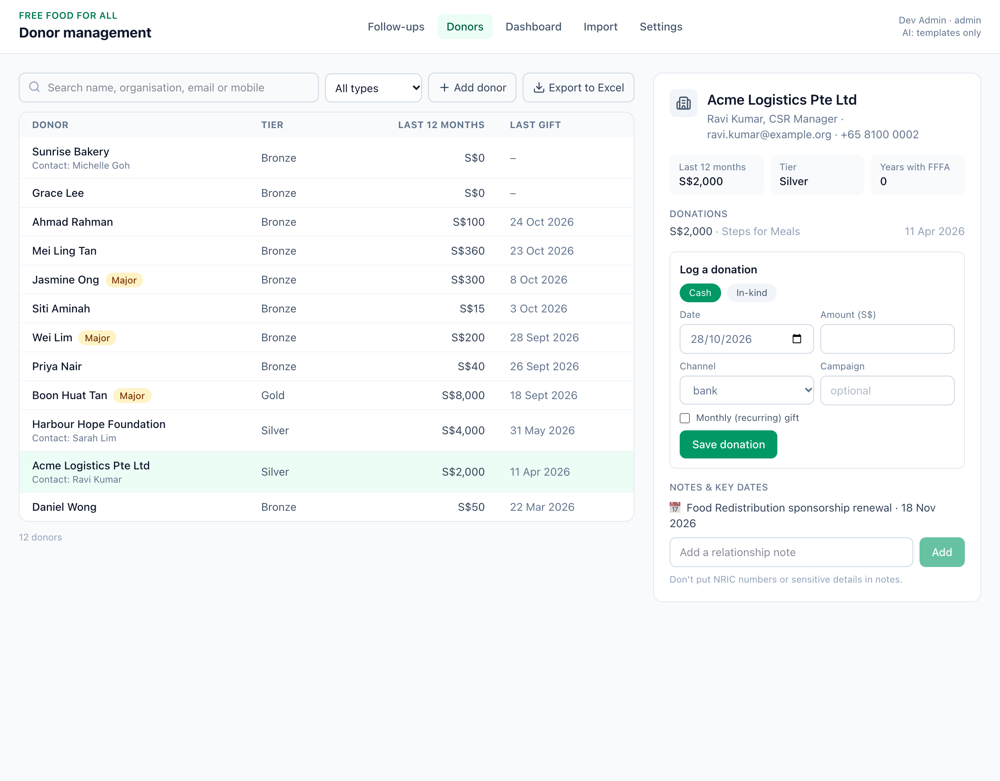
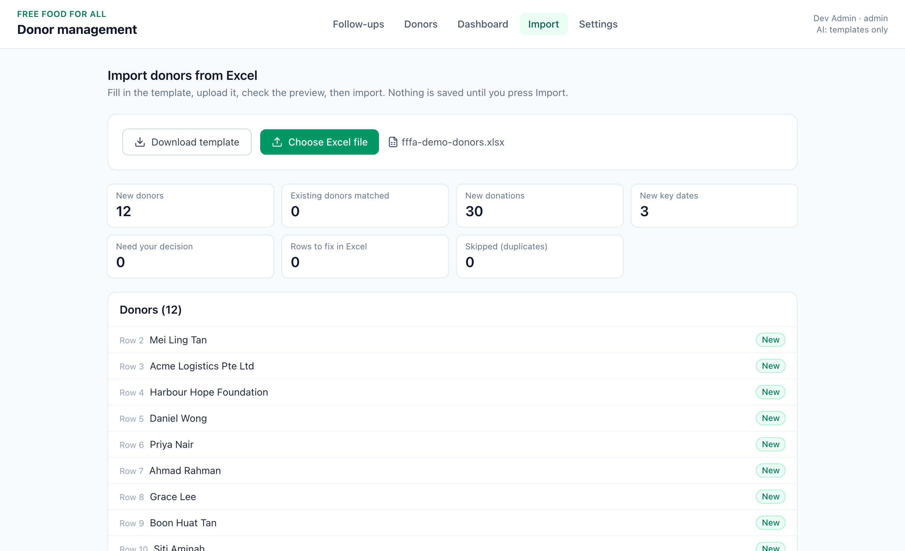

# FFFA Donor Management: Staff Operating Guide

*Version 1 · 28 October 2026 · for FFFA staff*

This system keeps every donor relationship in one place. It shows **who to follow up with and why**, helps write a warm, personal message, and keeps a record of every message sent, so relationships stay with FFFA when people move on. Nothing is ever sent by the system. A staff member reads, approves and sends every message.

The app has five tabs: **Follow-ups** (today's work), **Donors** (records), **Dashboard** (totals), **Import** (Excel uploads) and **Settings** (admins only).

> Practice data only (made-up donors) until FFFA's system is online with staff logins. See the Setup Guide.

---

## 1. Daily (10–15 minutes)

**Review the queue and donor history.** Open **Follow-ups** and press the **refresh icon** at the top of the list. This checks every donor against the rules and adds anything new. Each item says why the donor needs attention. Click a name to see their giving, tier, years with FFFA, notes, key dates and past messages.

**Complete approved outreach.** Draft, check and approve the message, then send it from your own email or WhatsApp (section 4). Major donors get a personal call, meeting or note instead (section 5).

**Record the outcome and the next action.** Click **Mark as sent** for messages: the exact text is saved on the donor's history and the item leaves the queue. For calls and meetings, add a short note on the donor's profile (**Donors** tab), e.g. *"Called 28 Oct: happy to renew sponsorship in Jan. Next: send renewal form by 15 Nov."* Start notes with the date and end with the next step.

---

## 2. Monthly (about 1 hour, with the team lead)

**Review trends, lapsed donors and recurring support** on the **Dashboard**:
- Giving and contacts by month, compared with last month
- How many follow-ups are *Lapsed*, *Failed payment* and *Going cold*
- Whether the number of monthly donors and their monthly total went up or down

Decide who will personally contact lapsed donors who used to give regularly.

**Check quality and priority relationships:**
- Read 5 messages sent this month (donor history). Were they accurate and warm? Share good examples. If staff keep rewriting the same thing, ask whoever looks after the system to change the template.
- Go through major donors, sponsors and grant funders on the **Donors** tab: is there a recent message or note, and are upcoming key dates recorded?
- Import the month's donations (section 8).
- An admin checks **Settings**: do the rule timings still suit FFFA's workload?

---

## 3. What each follow-up means

| Label | Why it appears | What to do |
|---|---|---|
| **Thank-you due** | A gift (cash or goods) not yet thanked, 3+ days old | Send a thank-you |
| **Failed payment** | A monthly gift on Giving.sg / GIVE.asia didn't go through (last 7 days) | Gentle note asking them to update their card. No pressure. |
| **Key date** | A sponsorship renewal, grant report or renewal due within 30 days | Get in touch about the renewal or report |
| **Going cold** | No message logged for a while (90 days for most donors, sooner for bigger givers) | Quick check-in with no ask |
| **Lapsed** | No gift for 45 days (monthly) or 6 months (one-off) | A light "we miss you" note |
| **Anniversary** | First-gift anniversary this week | Celebrate how long they've been with FFFA |
| **Upgrade ask** | Same monthly amount for 12+ months | Thank first, then one gentle invitation to give a little more |
| **Major donor** (yellow tag) | S$5,000+ in 12 months, 3+ years, or tagged | Personal outreach only |

---

## 4. Sending a message

1. **Generate draft.** It uses the donor's name, giving, interests, notes and key dates, never their email, mobile or ID numbers. The impact line (S$10 = 1 meal) is worked out by the system.
2. **Check it** before approving:
   - [ ] Right name, and for companies, the contact person
   - [ ] Every amount, date, programme and item matches the profile, with nothing added
   - [ ] No ask, unless it's an upgrade or renewal, and never more than one
   - [ ] Warm and simple, no pressure, no mention of tiers
   - [ ] Not already contacted about this in the last few days (check the history)
3. Edit anything that doesn't sound like FFFA, then **Approve**.
4. **Copy** (or **Open in email**) and send it yourself.
5. **Mark as sent** and choose how you sent it (email, WhatsApp, call, meeting, other).

**Regenerate** gives a fresh version, and **Discard** throws it away. "Template" on a draft means standard wording was used instead of AI. Check and send it the same way. If a draft contains anything wrong or made up, **don't send it**. Fix it, and tell whoever looks after the system.

---

## 5. Major donors: always personal

AI drafting is switched off for major donors. Their relationship owner calls, meets or writes personally, then adds a dated note on the donor's profile with what was discussed and the next step.

---

## 6. Owners, next actions and record upkeep

**Owners.** Every major donor, corporate sponsor and grant funder should have a **relationship owner**: the staff member who knows them best. Owners are set in the Excel import (`relationship_owner_email` column). The team lead keeps the list of owners. When someone leaves, the lead reassigns their donors the same day, and the new owner reads the donor's history and notes.

**Next actions.** Write the next step and its date at the end of a note. Key dates (renewals, reports) belong in the Key dates sheet of the Excel import, so the system reminds you 30 days ahead.

**Keeping records accurate:**

| Task | Where |
|---|---|
| Add a new donor | **Donors** → *Add donor* (search first, section 7) |
| Record a gift (cash or goods, one-off or monthly) | **Donors** → donor → *Log a donation* |
| Add a relationship note | **Donors** → donor → note box → *Add* |
| Add many donors, gifts or key dates at once | **Import** (section 8) |
| Change contact details, archive a donor, void a wrong gift, complete a key date | Ask an admin (there's no button for these yet) |
| Export all donors to Excel | **Donors** → *Export to Excel* (admins only, logged) |

Notes are for the relationship, like "prefers WhatsApp", "mum used RTE meals" or "met at Steps for Meals". **Never** write NRIC, FIN, UEN, bank details or sensitive personal matters.

---

## 7. Avoiding duplicate donors

One person, one record, even if they give on Giving.sg and GIVE.asia.

- **Search before adding** a donor on the **Donors** tab: try their email, then mobile, then name.
- **The import matches automatically** by email, then mobile. When it isn't sure (e.g. same name, different email), it shows **"Needs your decision"** and lets you pick the existing donor or create a new one. If in doubt, pick the existing donor and check with the team lead.
- **Re-uploading a file never double-counts** gifts with the same platform reference ("Already there").
- **If you spot a duplicate** already in the system, don't keep using both. Tell an admin, who keeps the record with the most history and archives the other, with a note on both.

---

## 8. Importing donors and donations

1. **Import** → **Download template**. It has an Instructions sheet and three sheets: **Donors** (required), **Donations** and **Key dates**. Keep the sheet names and headers.
2. Fill it in, or paste from your Giving.sg / GIVE.asia exports into the Donations sheet. For gifts that were already thanked, set `thanked` to **Yes**. Otherwise each one appears as a thank-you follow-up.
3. **Choose Excel file.** The preview shows what will happen, and nothing is saved yet:
   - **New** / **Existing donor**: will be added or matched
   - **Needs your decision**: pick the right donor
   - **Already there** / **Repeated in file**: skipped, never double-counted
   - **Fix in Excel**: correct the row in the file and upload again
4. Press **Import**. Then go to **Follow-ups** and press the refresh icon.

---

## 9. When to escalate

| Situation | Who | What |
|---|---|---|
| A major donor, sponsor or grant funder is unhappy, or a large gift arrives unexpectedly | Relationship owner, then team lead | Personal contact within 2 working days |
| A donor asks not to be contacted | Whoever receives it | Note it, tell an admin to archive the donor the same day |
| A donor asks to see, correct or delete their data (PDPA) | Admin / FFFA's data protection contact | Record the date, respond promptly per FFFA's policy |
| An AI draft is wrong, made up or inappropriate | Don't send. Tell whoever looks after the system. | Share the follow-up type and the wrong text (no contact details) |
| A monthly payment fails two months in a row | Relationship owner | Personal call or message, not another template |
| Import shows many "Needs your decision" or "Fix in Excel" rows | Team lead | Check the source file before importing |
| The system is down or showing errors | Whoever looks after the system | Setup Guide, section 10 |

---

## 10. House rules

- **Read every message before it goes out.** The draft is a starting point.
- **Tiers (Bronze to Diamond) are internal.** Never mention them to donors.
- **Exports contain personal data.** Store them securely and delete old copies.
- **Real donor data only in FFFA's live system with logins**, never in a practice copy on a laptop.
- **When in doubt, ask** before contacting a donor. A late message is better than a wrong one.
